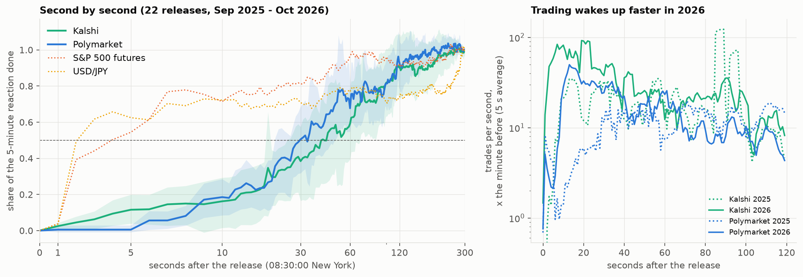
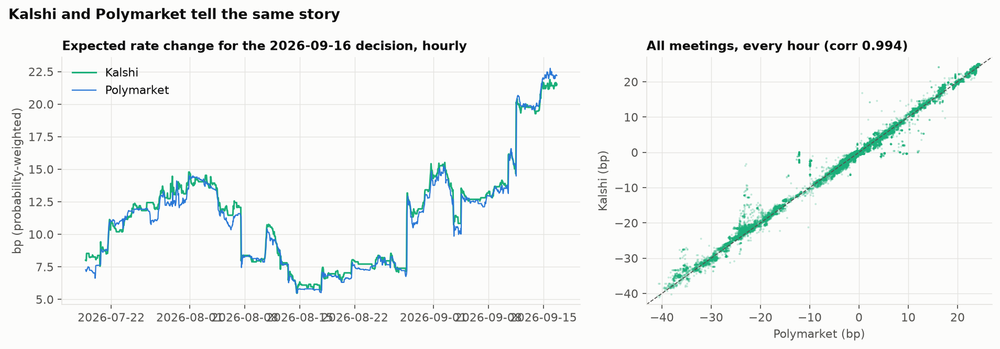
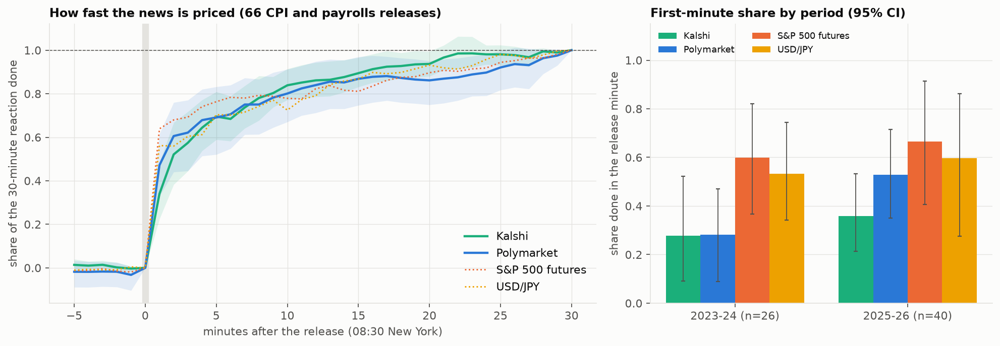
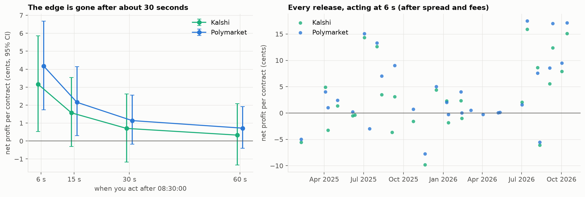
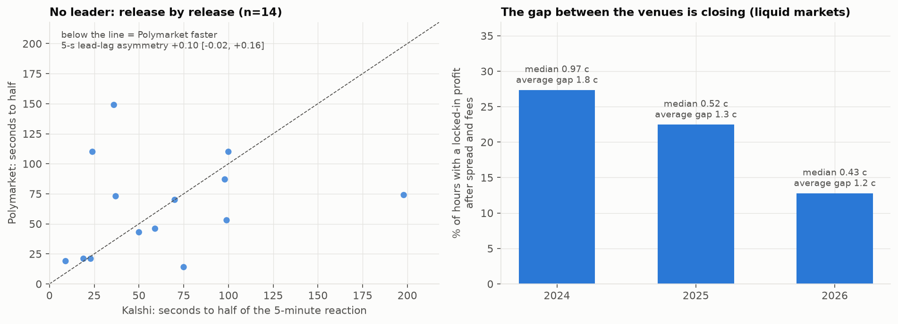
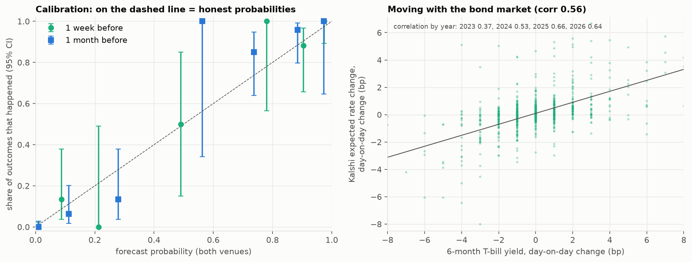

# Do Prediction Markets Know What the Fed Will Do?

[](https://github.com/unaifmm/prediction-markets-fed/actions/workflows/tests.yml)

[](LICENSE)

**Kalshi and Polymarket vs futures, the dollar and Treasury bills around US macro news, 2023-2026.**

Two prediction markets, Kalshi and Polymarket, let anyone bet on the next Federal Reserve decision: cut, hold or hike. Their prices read as probabilities. This project asks how good those probabilities are, and how fast they absorb new information compared with professional markets. It uses every Fed-decision market on both venues since May 2023 (31 meetings), every trade around 81 CPI and payrolls releases, 1-second S&P 500 futures and USD/JPY data, and daily Treasury yields.

*Unai Fueyo Montalvo · BSc Economics, Universidad Autónoma de Madrid · [LinkedIn](https://www.linkedin.com/in/unai-fueyo-montalvo-63823339b)*

**Read the paper:** [full paper (PDF, 9 pages)](docs/Prediction_Markets_Fed_paper.pdf) · [one-page summary (PDF)](docs/Prediction_Markets_Fed_summary.pdf)

## Key findings

1. **The data can be trusted.** Both venues paid out the decision that really happened at all 28 decided meetings (checked against the fed funds rate). Hour by hour, their expected rate change correlates 0.994, with a typical gap of 0.4 basis points.
2. **They are slow at the news.** After CPI and payrolls, S&P 500 futures and USD/JPY do half of their 5-minute reaction in 3-4 seconds. Kalshi needs about 41 seconds and Polymarket about 30 (Sep 2025 - Oct 2026), down from 95-110 seconds in 2025.
3. **The lag can be traded, briefly and in small size.** Reading USD/JPY's first 5 seconds and trading the favourite outcome of the next meeting earns +3 to +4 cents per contract after spread and fees, +5 to +7 cents when the decision is a close call. Acting after 30 seconds, or paying one cent more, makes it statistically indistinguishable from zero, and only a few thousand dollars trade at those prices.
4. **Neither venue leads the other.** Their reactions are equally fast. Their prices for the same outcome differ by more than the cost of trading the gap in about 20% of hours, by about half a cent, and that is shrinking (27% of hours in 2024, 13% in 2026).
5. **The forecasts are good.** The favourite outcome happened at 28 of 28 meetings one day before the decision, 27 of 28 one week before (the miss: the 50 bp cut of September 2024) and about 92% one month before, against 68% for "the Fed holds". Day to day they move with the 6-month T-bill (correlation about 0.6 in 2025-26, up from 0.2-0.4 in 2023).



---

## Research questions

1. **Speed.** After a CPI or payrolls release, how fast do the prediction markets reprice the next Fed decisions, compared with S&P 500 futures and USD/JPY?
2. **Economic significance.** Is the lag large enough to profit from after spreads and fees, and for how long?
3. **Two venues.** Does Kalshi or Polymarket move first, and do their prices for the same outcome differ by more than the costs of trading the gap?
4. **Accuracy.** How good are their forecasts, and do they move with the bond market?

## Data

| Source | What | Period |
|---|---|---|
| [Kalshi](https://kalshi.com) public API | "Fed decision in <month>?" markets (KXFEDDECISION): hourly prices over each market's life, 1-minute prices and every trade around each release | May 2023 - Oct 2026, 31 meetings |
| [Polymarket](https://polymarket.com) public APIs (Gamma, CLOB, Data) | The monthly Fed decision events: the same three kinds of data | same |
| London Strategic Edge | US macro calendar; 1-minute S&P 500 futures (ES), USD/JPY and TLT; 1-second ES and USD/JPY around releases | 2023 - 2026 (1-second ES from Sep 2025) |
| FRED (St. Louis Fed) | Daily effective fed funds rate, SOFR, 3- and 6-month T-bills, 1-, 2- and 10-year Treasury yields | 2023 - 2026 |

The prediction-market APIs need no account. Raw data is not included in the repository (size and the vendors' terms); `01_download_data.py` rebuilds it.

**From prices to one number.** Each meeting has four to six outcomes (cut 50, cut 25, hold, hike 25, ...). The YES price of each reads as its probability. The *expected rate change* is the probability-weighted average change, rescaled so the probabilities add up to 1 (e.g. 85% hold and 15% hike 25 bp = +3.75 bp). Around releases we use the sum over the next two meetings.

## Validation first: four data problems found and fixed

| Problem | How it was found | Fix |
|---|---|---|
| Kalshi's historical endpoint gives prices in dollars without the `_dollars` suffix, so prices before Aug 2026 were read as cents (100x too small) | The outcome prices of a meeting added up to 0.01 instead of 1 | Read as dollars; unit test for all three formats |
| Polymarket stamps its 1-minute prices 2-11 seconds into each minute | On its own time stamps, its biggest move after CPI and payrolls never fell in the release minute (0% of releases, vs 77% for S&P futures) | Read each minute price as the start of its minute; second-level results use exact trade times |
| Old Kalshi tickers contain `>` (e.g. `H>25`), not allowed in Windows file names or URLs | The download crashed on Windows | Safe file names and URL escaping; unit test |
| Many 2023-24 Polymarket markets had empty order books (price stuck at exactly 0.50) | Cross-venue "gaps" of 20-40 cents | Price-gap tests use liquid meetings only ($10M+ traded, from Sep 2024); the full sample is shown separately |

And two checks on the whole data set: both venues paid out the true decision at all 28 meetings, and around CPI and payrolls every market's biggest move falls in the release minute (S&P futures 77%, USD/JPY 73%), so the clocks agree.



## Results

### 1. Speed, minute by minute (`03_speed.py`, 66 releases with all four markets)

Share of the 30-minute reaction done after h minutes, pooled over releases (each weighted by the size of its reaction; 95% bootstrap CI):

| | 1 minute | 5 minutes | 15 minutes |
|---|---|---|---|
| Kalshi | 0.34 [0.22, 0.48] | 0.70 | 0.89 |
| Polymarket | 0.47 [0.33, 0.62] | 0.69 | 0.87 |
| S&P 500 futures | 0.64 [0.47, 0.81] | 0.76 | 0.81 |
| USD/JPY | 0.56 [0.40, 0.74] | 0.70 | 0.87 |



### 2. Speed, second by second (`04_seconds.py`)

From trades (prediction markets) and 1-second bars (futures, FX), 22 releases since September 2025 with all four markets: seconds until half of the 5-minute reaction is done.

| USD/JPY | S&P 500 futures | Polymarket | Kalshi |
|---|---|---|---|
| 3 s [2, 9] | 4 s [2, 10] | 30 s [21, 49] | 41 s [19, 70] |

In 2025 the prediction markets needed 93-110 seconds; in 2026, 30-40. The first trade after 08:30:00 now comes after about 10-12 seconds on both venues.

### 3. Can you profit from the lag? (`05_lag_trade.py`, 41 releases since January 2025)

Signal: USD/JPY's move in the first 5 seconds (always at least 6x its normal 5-second move). Trade: the favourite outcome of the next meeting, entered at the first real trade on our side after +6 seconds and exited 5 minutes later, paying the spread and both venues' taker fees (Kalshi 0.07 x p x (1 - p) per contract; Polymarket its own rate x p x (1 - p)).

| Net cents per contract (95% CI) | Kalshi | Polymarket |
|---|---|---|
| Act at 6 s | +3.2 [0.5, 5.9] | +4.2 [1.7, 6.7] |
| ... when the favourite is below 85% | +5.5 [2.0, 8.8] | +7.3 [3.8, 10.7] |
| ... when it is 85% or more | -1.2 [-2.7, 0.2] | -0.2 [-1.5, 0.8] |
| Act at 30 s | +0.7 [-1.2, 2.6] | +1.1 [-0.2, 2.6] |
| Act at 6 s, one cent worse on each side | +1.2 [-1.5, 3.9] | +2.2 [-0.3, 4.7] |
| Opposite trade (sanity check) | -7.0 | -5.2 |

About $6,500 (Kalshi) and $13,500 (Polymarket) traded on our side within 30 seconds of entry at a typical release: a few hundred dollars of profit per release at most. As Grossman and Stiglitz (1980) predict, the lag survives only up to the cost and capacity of exploiting it.

*Design note:* a first version traded the most uncertain meeting, often a later one whose contracts barely traded at 08:30; most orders could not be filled. The next meeting's favourite was chosen for liquidity before looking at profits, and every variant tried is reported.



### 4. Kalshi vs Polymarket (`06_venues.py`)

- **No leader.** Lead-lag asymmetry on 5-second changes +0.10 [-0.02, +0.16], using only intervals in which both venues traded (a venue that trades less looks like a follower even when it is not: the staleness trap). Half-lives on 14 releases where both moved: Kalshi 54 s, Polymarket 62 s, difference -1 s [-13, +10].
- **Small, shrinking gaps.** Buying YES on the cheaper venue and NO on the dearer one locks in $1 at the decision. After Kalshi's spread, an assumed 0.5-cent Polymarket half-spread and both fees, this leaves a profit in 19.5% of hours (median 0.54 cents): 27% in 2024, 22% in 2025, 13% in 2026. What keeps it open: few traders can use both venues (Kalshi is a US-regulated exchange, Polymarket runs on crypto), the money is tied up until the decision, and the depth at those prices is unknown.



### 5. Accuracy and the bond market (`07_accuracy_bonds.py`)

| Before the decision | Favourite happened (Kalshi / Polymarket) | Brier score |
|---|---|---|
| 1 day | 100% / 100% (28 meetings) | 0.021 / 0.021 |
| 1 week | 96% / 96% | 0.090 / 0.087 |
| 1 month | 93% / 92% | 0.150 / 0.168 |

Benchmarks without market information: "the Fed holds" is right 68% of the time, "the Fed repeats its last decision" 67%. A month ahead, outcomes priced at 20-40% happened only 13% of the time (n = 15): a hint of the favourite-longshot bias known from betting markets (Thaler and Ziemba, 1988), but 28 meetings cannot confirm it.

Day to day (16:00 New York), the expected rate change over the next two decisions moves with the 6-month T-bill: correlation 0.56 (Kalshi) and 0.46 (Polymarket), rising from 0.37 / 0.23 in 2023 to 0.66 / 0.61 in 2025. Neither clearly moves first from one day to the next.



## Limitations

- **Small samples.** 28 decided meetings, 81 releases, 41 with second-level data; confidence intervals are wide and stated everywhere.
- **Trades, not order books.** Speeds and fills are measured from trades. Quotes can move before trades, and the depth behind each price is unknown, so trade-based speed is a slightly pessimistic reading and the trading capacity an estimate.
- **No rate futures.** The vendor has no fed funds or SOFR futures, the professional benchmark for Fed expectations. The comparison uses USD/JPY and S&P 500 futures intraday and Treasury bills daily.
- **Polymarket spreads are assumed** (0.5 cent, 1 cent as robustness): its price history has no quotes.
- **Access is not modelled.** Kalshi and Polymarket serve different users, which the price-gap test treats as a reason the gaps persist rather than a cost.

## How to run

```bash
python -m venv .venv
.venv\Scripts\activate            # Windows (macOS/Linux: source .venv/bin/activate)
pip install -r requirements.txt
lse auth YOUR_KEY                 # only for the London Strategic Edge parts (calendar, futures, FX)
python run_all.py --download      # first time: download everything (30-60 minutes), then run every step
python run_all.py                 # later: re-run the analysis on the data you have (about 2 minutes)
```

The unit tests (`python -m pytest`, a few seconds) need no data and no key; they run on GitHub at every change.

## Project structure

```
├── 00_data_check.py            step 0: what data exists? (one-off check, writes data_check/report.txt)
├── 01_download_data.py         download Kalshi, Polymarket, FRED and London Strategic Edge data
├── 02_data_checks.py           settlement, coherence, venue agreement, clocks
├── 03_speed.py                 Q1: speed of the reaction, minute by minute
├── 04_seconds.py               Q1: the first minutes, second by second
├── 05_lag_trade.py             can you profit from the lag? (after spread and fees)
├── 06_venues.py                Q2: Kalshi vs Polymarket: who moves first, price gaps vs costs
├── 07_accuracy_bonds.py        Q3: forecast accuracy, calibration, the bond market
├── run_all.py                  one command: tests + every step in order
├── src/
│   ├── config.py               folders, sample, sources, settings
│   ├── webapi.py               polite JSON client (rate limits, retries)
│   ├── kalshi.py               Kalshi markets, candles, trades
│   ├── polymarket.py           Polymarket events, price history, trades
│   ├── fred.py                 daily rates from FRED
│   ├── lse.py                  London Strategic Edge download (from project 1)
│   ├── events.py               macro releases and their official times (from project 1)
│   ├── meetings.py             one row per FOMC meeting, both venues mapped to it
│   ├── probs.py                prices -> probabilities -> expected rate change
│   ├── trades.py               trade prices around releases, second by second
│   └── plots.py                shared chart style
├── docs/                       the paper and its one-page summary
├── tests/                      unit tests (pytest), no data needed
├── figures/                    output charts
└── results/                    output tables (CSV)
```

## Related project

[Who Moves First? Information diffusion between Nasdaq-100 and S&P 500 futures and ETFs](https://github.com/unaifmm/information-diffusion-nasdaq-sp500): the same toolkit (validation first, lead-lag, event study, economic significance) on equity-index markets.

## License

Code: MIT (see `LICENSE`). Data is not included; it belongs to its providers.

## References

- Andersen, T. G., Bollerslev, T., Diebold, F. X. & Vega, C. (2003). Micro effects of macro announcements: Real-time price discovery in foreign exchange. *American Economic Review*, 93(1), 38-62.
- Brier, G. W. (1950). Verification of forecasts expressed in terms of probability. *Monthly Weather Review*, 78(1), 1-3.
- Budish, E., Cramton, P. & Shim, J. (2015). The high-frequency trading arms race: Frequent batch auctions as a market design response. *Quarterly Journal of Economics*, 130(4), 1547-1621.
- Diercks, A. M., Katz, J. D. & Wright, J. H. (2026). Kalshi and the rise of macro markets. Finance and Economics Discussion Series 2026-010, Federal Reserve Board; NBER Working Paper 34702. The closest study: daily Kalshi data, accuracy and end-of-day news effects; this project adds second-level speed, Polymarket and tradability.
- Epps, T. W. (1979). Comovements in stock prices in the very short run. *Journal of the American Statistical Association*, 74(366), 291-298.
- Grossman, S. J. & Stiglitz, J. E. (1980). On the impossibility of informationally efficient markets. *American Economic Review*, 70(3), 393-408.
- Kuttner, K. N. (2001). Monetary policy surprises and interest rates: Evidence from the Fed funds futures market. *Journal of Monetary Economics*, 47(3), 523-544.
- Shleifer, A. & Vishny, R. W. (1997). The limits of arbitrage. *Journal of Finance*, 52(1), 35-55.
- Thaler, R. H. & Ziemba, W. T. (1988). Anomalies: Parimutuel betting markets: Racetracks and lotteries. *Journal of Economic Perspectives*, 2(2), 161-174.
- Wolfers, J. & Zitzewitz, E. (2004). Prediction markets. *Journal of Economic Perspectives*, 18(2), 107-126.

*For research and educational purposes only; not investment advice. The Python code was written with the help of AI coding assistants; the research questions, design and interpretation are the author's.*
